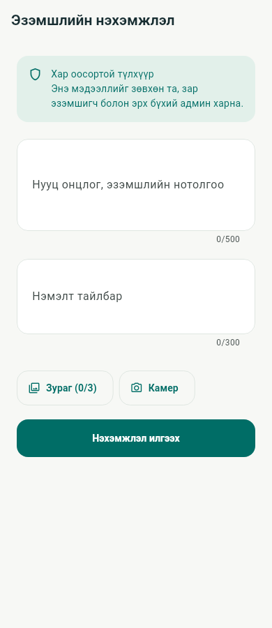
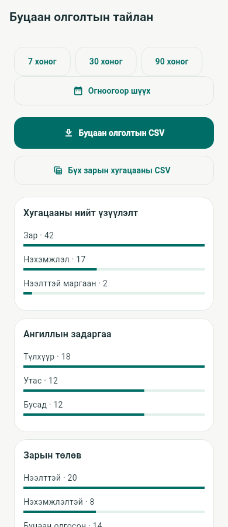

# Хэрэглэгч ба админы гарын авлага

1. Бүртгүүлээд нэр, утас, мэдээлэл ашиглах зөвшөөрлөө гүйцээнэ. Имэйлээр нууц үг сэргээх, профайлаас нэр/утас, одоогийн нууц үгээр баталгаажуулж password солих боломжтой.
2. **Миний зар → Зар нэмэх**: Lost/Found, нэр, ангилал, дүүрэг, тодорхой газар, огноо, тайлбар, нууц онцлог. Галерей/камераас 5 хүртэл JPG/PNG (<5MB) зураг. Нууц онцлогоо нийтийн тайлбарт бичихгүй.
3. **Хайх**: 3+ тэмдэгттэй үгийн эхлэл; төрөл/ангилал/дүүрэг/огнооны хүрээ/төлөв. Дараагийн хуудсыг ачаалж болно.
4. **Миний зар → Дэлгэрэнгүй → Тохирох зарууд**: эсрэг төрлийн боломжит зар, оноо/задаргаа.
5. Бусдын Found зар дээр **Миний эд зүйл мөн**: нууц онцлог, эзэмшлийн тайлбар, 3 хүртэл хувийн нотлох зураг. Давхар идэвхтэй хүсэлт хориглоно.
6. **Хүсэлт → Ирсэн хүсэлт**: нийтлэгч нотолгоо шалгаад батлах эсвэл шалтгаантай татгалзана. Нэг хүсэлт батлагдахад бусад pending автоматаар rejected болно.
7. Verified хүсэлтийн дэлгэрэнгүйд зөвхөн тухайн хоёр талд контакт нээгдэнэ. Нийтлэгч ирээдүйн уулзах цаг/газар товлоно. Бодитоор хүлээлцсэний дараа **Буцаан олгосон** гэж тэмдэглэнэ.
8. Rejected хүсэлт дээр **Маргаан үүсгэх**: үндэслэл/нотолгоо; админы шийдвэр мэдэгдлээр ирнэ.
9. **Мэдэгдэл**: бүгд/уншаагүй, нэг болон бүгдийг уншсан болгох. Профайлаас төхөөрөмжийн мэдэгдлийн зөвшөөрөл авна.

Идэвхтэй баталгаажаагүй өөрийн зарыг засна. Идэвхтэй claim/маргаан эсвэл returned түүхтэй зарыг устгахгүй. Хөдөлгөөнгүй open/claimed зар 30 хоногт хугацаа дуусна.

## Админ

Профайл → **Удирдлага** (серверийн admin custom claim шаардлагатай).

- Dashboard: хэрэглэгч/зар/claim/returned/open dispute тоо.
- Зарууд: хайлт/төлөв/төрөл/огноо; дэлгэрэнгүйд шалтгаантай нуух/ил гаргах.
- Маргаан: open/resolved, claim-ийн нууц хариулт, олсон хүний нууц шинж, зураг, татгалзлын үндэслэл, эцсийн тайлбар/шийдвэр. Буцаагаагүй зарт буруу verified winner-ийг атомикаар залруулж чадна; хоёр хүчинтэй winner зэрэг үүсэхгүй.
- Хэрэглэгчид: нэр/имэйл/утас/UID хайлт, үүргээр шүүх, зар/claim count. Эрхийг зөвхөн trusted script олгоно.
- Тайлан: 7/30/90 хоног эсвэл date range, нийт үзүүлэлт/ангилал/төлөв/сарын bar chart, returned жагсаалт. Бүх сонгосон зар эсвэл буцаалтын CSV-ийг Android share sheet-ээр хадгалах/хуваалцах.
- Аудит: actor/time/action/target/note, хайлт/үйлдлийн шүүлтүүр. Client-ээс засах/устгах эрхгүй.

## Acceptance жишээ

Owner-аар Found зар үүсгээд claimant-аар хүсэлт гаргана. Батлахаас өмнө контакт байхгүйг шалгана. Хоёр claimant зэрэг хүсэлт гаргаад нэгийг батлахад нөгөө нь rejected болохыг шалгана. Rejected хэрэглэгчээр маргаан үүсгэж админаар шийднэ. Winner-тэй хүлээлцээд returned болгох, шинэ claim хориг, мэдэгдэл/тайлан/аудит шинэчлэлтийг шалгана.

## UI жишээ

Эдгээр нь Flutter widget renderer-ээс жишээ өгөгдөлтэй гаргасан дүрслэл; бодит хэрэглэгчийн мэдээлэл эсвэл төхөөрөмжийн runtime screenshot биш.

